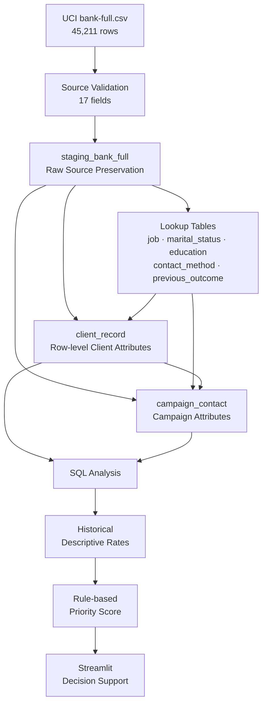

<div align="center">

# Bank Marketing SQL Analysis 🏦

### Relational Data Modeling · SQL Analytics · Rule-based Decision Support

**UCI Bank Marketing 데이터를 관계형 스키마로 재구성하고  
재현 가능한 MySQL 분석 결과를 규칙 기반 마케팅 우선순위 도구로 연결한  
Database & SQL 프로젝트**

<br/>

[](https://www.mysql.com/)
[](https://www.python.org/)
[](https://streamlit.io/)

[]()
[]()
[](https://github.com/tangerineYR/bank-marketing-sql-analysis/actions/workflows/ci.yml)

</div>

---

## 📌 Overview

이 프로젝트는 데이터베이스 전공 수업에서 수행한 개인 프로젝트로, **은행 텔레마케팅 데이터를 관계형 데이터베이스로 모델링하고 SQL 분석 결과를 마케팅 의사결정 지원 도구로 연결하는 것**을 목표로 했습니다.

2025년 Historical Project에서는 UCI Bank Marketing CSV를 MySQL에 적재하고 직업·연령·연락 시기·연락 방식·이전 캠페인 결과에 따른 정기예금 가입률을 분석했습니다. 이후 분석 결과를 수동 가중치로 변환해 Streamlit 기반의 마케팅 대상 우선순위 UI를 구현했습니다.

2026년 Portfolio Refactoring에서는 원래 프로젝트의 범위를 확장하기보다 **데이터 적재 무결성, 스키마 의미, 재현성, 테스트 가능성**을 보강했습니다.

```text id="brh9tk"
UCI bank-full.csv
       ↓
Raw Staging
       ↓
Normalized Relational Schema
       ↓
Transactional Loader
       ↓
SQL Descriptive Analysis
       ↓
Rule-based Priority Score
       ↓
Streamlit Decision Support
```

### Project Info

| 항목 | 내용 |
| --- | --- |
| **프로젝트 유형** | 데이터베이스 전공 프로젝트 · 개인 |
| **수행 시기** | 3학년 1학기 |
| **Dataset** | UCI Bank Marketing · `bank-full.csv` |
| **Source Rows** | 45,211 |
| **Database** | MySQL 8.x |
| **Schema** | 1 staging + 7 normalized/domain tables |
| **Analysis** | SQL · Pandas |
| **Application** | Streamlit |
| **Decision Logic** | 5-factor rule-based priority score |
| **Validation** | 21 automated tests · MySQL GitHub Actions |

---

# 🏗️ Architecture



---

# 🗃️ Relational Schema

전체 database는 **8개 table**로 구성됩니다.

```text id="hdt42f"
1 staging table
+
5 lookup tables
+
1 client_record
+
1 campaign_contact
=
8 tables
```

## Raw Staging

### `staging_bank_full`

원본 CSV의 모든 17개 field를 보존합니다.

각 row에는:

```text id="hfrfrq"
source_row_id
```

라는 deterministic ID를 부여합니다.

`source_row_id`는 **CSV row를 식별하기 위한 값이며 실제 은행 고객 ID가 아닙니다.**

---

## Lookup Tables

```text id="8e0pel"
job
marital_status
education
contact_method
previous_outcome
```

반복되는 categorical value를 별도 relation으로 분리하고 각각:

```text id="6d9ti3"
Primary Key
Unique
Not Null
```

제약을 적용합니다.

---

## `client_record`

원본 row의 고객 특성 영역을 담당합니다.

```text id="30o58z"
source_row_id
age
job_id
marital_status_id
education_id
default_credit
balance
housing
loan
```

UCI dataset에는 persistent customer identifier가 제공되지 않기 때문에 이 table을 **deduplicated real customer master**라고 해석하지 않습니다.

---

## `campaign_contact`

캠페인 및 연락 정보를 보존합니다.

```text id="tz89dj"
source_row_id
contact_method_id
day
month
duration
campaign
pdays
previous
previous_outcome_id
subscribed
```

Historical implementation에서 빠져 있던 `duration`과 `pdays`도 현재 relational representation에서는 보존합니다.

다만 `duration`은 통화 종료 후에만 알 수 있는 값이므로 **사전 마케팅 대상 priority score에는 사용하지 않습니다.**

---

# 🔒 Transactional & Reproducible Loading

Historical notebook에서는 cell을 재실행할 때 `Customer`와 `Campaign` row가 다시 INSERT될 수 있었습니다.

실제 과거 notebook output에서는 일부 집계가:

```text id="g2g85m"
45,211 × 6
=
271,266
```

으로 증가한 상태가 확인됐습니다.

비율은 동일하게 복제되어 겉으로는 정상처럼 보였지만, absolute row count와 database state는 잘못된 상태였습니다.

2026 refactoring에서는 적재 과정을 별도의 transactional loader로 분리했습니다.

```text id="kqa9yt"
Validate CSV
     ↓
Acquire DB Load Lock
     ↓
Initialize Schema
     ↓
Begin Transaction
     ↓
Replace Project Data
     ↓
Load Staging
     ↓
Load Lookups
     ↓
Load Relational Tables
     ↓
Integrity Verification
     ↓
Commit
```

오류가 발생하면 transaction을 rollback하여 이전 정상 적재 상태를 유지합니다.

---

## Idempotency

같은 dataset을 두 번 적재해도 row 수가 증가하지 않습니다.

| Relation | First Load | Second Load |
| --- | ---: | ---: |
| Source CSV | 45,211 | 45,211 |
| `staging_bank_full` | 45,211 | 45,211 |
| `client_record` | 45,211 | 45,211 |
| `campaign_contact` | 45,211 | 45,211 |

추가로 다음을 검증합니다.

```text id="9wmydr"
duplicate source_row_id = 0
FK orphan             = 0
```

그리고 relational tables를 다시 JOIN했을 때 원본 17개 field가 source CSV와 동일하게 복원되는지도 integration test에서 확인합니다.

---

# 📊 SQL Analysis

분석 query는 notebook에서 분리해 [`sql/analysis.sql`](sql/analysis.sql)에 유지합니다.

현재 분석 항목은:

```text id="wf1ot4"
Overall Subscription Rate
Job
Age Band
Contact Month
Contact Method
Previous Campaign Outcome
```

입니다.

모든 grouping 결과의 row count 합계가 원본:

```text id="efg7x1"
45,211
```

과 일치하는지 자동 검증합니다.

---

# 📈 Historical Findings

아래 수치는 **과거 데이터에서 관찰된 기술통계**이며 미래 고객의 가입확률이나 마케팅의 인과 효과를 의미하지 않습니다.

## Overall

```text id="cwtkw8"
Overall Subscription Rate
11.698%
```

---

## Job

| Job | Subscription Rate |
| --- | ---: |
| **Student** | **28.678%** |
| **Retired** | **22.792%** |

특히 student group은 실제 원본 기준 **938 rows**입니다.

---

## Age Band

| Age | Subscription Rate |
| --- | ---: |
| **< 30** | **17.599%** |
| 30–39 | 10.575% |
| 40–49 | 9.121% |
| **50+** | **13.586%** |

이 분석 결과를 기반으로 priority score의 age boundary도 동일하게 맞췄습니다.

---

## Contact Month

| Month | Subscription Rate |
| --- | ---: |
| **March** | **51.992%** |
| **September** | **46.459%** |
| **October** | **43.767%** |
| **December** | **46.729%** |

---

## Contact Method

| Method | Subscription Rate |
| --- | ---: |
| Cellular | 14.919% |
| Telephone | 13.421% |
| Unknown | 4.071% |

---

## Previous Campaign Outcome

이전 캠페인 결과가 `success`인 표본에서는:

```text id="kmsjtf"
64.725%
```

의 가입률이 관찰됐습니다.

이는 전체 가입률 11.698%보다 높은 historical association이지만, **개별 고객의 가입 probability나 causal effect를 의미하지 않습니다.**

---

# 🎯 Rule-based Marketing Priority

이 프로젝트의 Streamlit application은 ML classifier가 아닙니다.

SQL 분석 결과를 참고하여 사람이 설계한:

> **hand-designed heuristic priority score**

입니다.

```text id="2vkrb6"
Historical SQL Analysis
        ↓
Manual Business Rules
        ↓
Priority Score
        ↓
4-level Targeting Priority
```

---

## Five Scoring Factors

| Factor | Rule |
| --- | --- |
| **Job** | student / retired +3, selected groups +2 / +1 |
| **Age** | `<30` or `50+` +2, `30–39` +1 |
| **Month** | Mar / Sep / Oct / Dec +2 |
| **Contact** | cellular +2, telephone +1 |
| **Previous Outcome** | success +4, failure −1 |

총 점수 범위는:

```text id="zt93vs"
-1 ~ 13
```

입니다.

---

## Priority Grades

| Score | Priority |
| --- | --- |
| **8+** | 최우선 타겟 |
| **5–7** | 우선 타겟 |
| **3–4** | 일반 검토 |
| **< 3** | 낮은 우선순위 |

각 결과에는 적용된 5개 factor와 점수 근거를 함께 표시합니다.

예:

```text id="c7req1"
+3 직업: student
+2 연령대: 29세
+2 연락 월: mar
+2 연락 방식: cellular
+4 이전 캠페인 결과: success
────────────────────────
13 → 최우선 타겟
```

이 점수는 **calibrated probability가 아닙니다.**

---

# 🧪 Tests & CI

현재 repository에는 **21개의 automated tests**가 있습니다.

```text id="1mr6y1"
Data contract tests       5
Database integration      7
Scoring tests             9
──────────────────────────
Total                    21
```

주요 검증 범위:

```text id="hs0o1t"
45,211 source rows
17 expected source fields
5,289 subscribed rows
student absolute count = 938

8-table schema
PK / FK / UNIQUE / CHECK constraints
double-load idempotency
full source-column round trip
transaction rollback
foreign-key integrity

SQL aggregate counts
historical descriptive rates

age boundaries
score weights
priority boundaries
score range
invalid input rejection
```

GitHub Actions에서는 MySQL 8.4 service를 실행해 실제 DB integration test까지 수행합니다.

```text id="i6gvdl"
Python 3.12
     ↓
MySQL 8.4
     ↓
Install Dependencies
     ↓
Run 21 Tests
     ↓
Run SQL Analysis
     ↓
Validate Artifact
     ↓
git diff --check
```

현재 `main` workflow는 통과합니다.

---

# 🛠️ Tech Stack

| Category | Technology |
| --- | --- |
| **Database** | MySQL 8.x |
| **SQL** | DDL · JOIN · GROUP BY · CASE · Aggregation |
| **Data Processing** | Python · Pandas |
| **Database Driver** | PyMySQL |
| **Application** | Streamlit |
| **Testing** | Python unittest |
| **CI** | GitHub Actions · MySQL service |
| **Domain** | Relational Modeling · SQL Analytics · Decision Support |

---

# 📁 Project Structure

```text id="e25fja"
bank-marketing-sql-analysis/
│
├── bank-full.csv
├── config.py
├── scoring.py
├── 마케팅추천프로그램.py
├── 데이터정규화및분석.ipynb
│
├── sql/
│   ├── schema.sql
│   └── analysis.sql
│
├── scripts/
│   ├── __init__.py
│   ├── load_data.py
│   └── run_analysis.py
│
├── tests/
│   ├── test_data_contract.py
│   ├── test_database.py
│   └── test_scoring.py
│
├── docs/
│   ├── historical-report-2025.pdf
│   └── historical-presentation-2025.pdf
│
├── .github/
│   └── workflows/
│       └── ci.yml
│
├── .env.example
├── .gitignore
├── requirements.txt
└── README.md
```

---

# ▶️ Reproduction

## 1. Environment

Python 3.12와 MySQL 8.x 환경을 준비합니다.

```bash id="nscb0y"
git clone https://github.com/tangerineYR/bank-marketing-sql-analysis.git
cd bank-marketing-sql-analysis

python -m venv .venv
```

환경 활성화 후:

```bash id="sp1h7e"
pip install -r requirements.txt
```

---

## 2. Database Configuration

`.env.example`을 참고해 환경변수를 설정합니다.

```text id="wwzqgk"
DB_HOST
DB_PORT
DB_USER
DB_PASSWORD
DB_NAME
```

실제 credential은 repository에 저장하지 않습니다.

---

## 3. Load Data

```bash id="of9cq3"
python -m scripts.load_data
```

정상 완료 시:

```text id="w28kdp"
staging_bank_full    45,211
client_record        45,211
campaign_contact     45,211
FK orphan            0
duplicate source ID  0
```

을 검증합니다.

---

## 4. Run SQL Analysis

```bash id="qo1jrb"
python -m scripts.run_analysis
```

분석 결과는 CI에서 machine-readable artifact로 생성됩니다.

---

## 5. Run Streamlit

```bash id="8jj3ud"
streamlit run 마케팅추천프로그램.py
```

Streamlit application은 DB에서 실시간 probability prediction을 수행하는 서비스가 아니라, **SQL 분석을 바탕으로 설계한 독립형 rule-based priority tool**입니다.

---

# 🔄 Historical Project vs Portfolio Refactoring

| 구분 | 2025 Historical Project | 2026 Portfolio Refactoring |
| --- | --- | --- |
| Data | UCI `bank-full.csv` | 원본 그대로 보존 |
| Schema | Lookup + Customer + Campaign | 의미 명확한 1 staging + 7 domain tables |
| Customer ID | Insert order 기반 추정 | deterministic `source_row_id` |
| Loading | 반복 실행 시 중복 가능 | transactional & idempotent |
| Fields | `duration`, `pdays` 일부 누락 | 원본 17 field round-trip 검증 |
| SQL | Notebook 내부 분석 | executable `analysis.sql` |
| Scoring | UI 내부 함수 | pure `scoring.py` |
| Age Rule | `<=25` | SQL 분석과 맞춘 `<30` |
| Output | 가입 가능성 표현 | marketing priority 표현 |
| Validation | 수동 | 21 automated tests |
| CI | 없음 | MySQL 8.4 integration CI |

2026 refactoring은 새로운 ML model을 추가한 것이 아니라, **기존 데이터베이스 프로젝트의 의미와 무결성을 실제 코드 수준에서 검증 가능하도록 만든 작업**입니다.

---

# ⚠️ Scope & Limitations

**No Persistent Customer ID**

UCI source에는 실제 고객을 지속적으로 식별할 수 있는 customer ID가 제공되지 않습니다. `client_record`는 source row 단위 relation이며 실제 고객 중복 제거를 의미하지 않습니다.

**Not a Probability Model**

Priority score는 SQL 기술통계를 참고해 사람이 설계한 heuristic rule입니다. 통계적으로 학습되거나 calibration된 가입확률이 아닙니다.

**No Causal Claim**

특정 직업·연령·월·이전 캠페인 결과와 높은 가입률의 관계는 historical association입니다. 해당 변수를 바꾸면 가입률이 상승한다는 인과관계를 의미하지 않습니다.

**Duration Excluded from Targeting**

`duration`은 relational schema에는 보존하지만 통화가 종료된 후에만 알 수 있으므로 사전 targeting score에는 사용하지 않습니다.

**Historical Dataset**

이 프로젝트는 UCI가 공개한 historical Bank Marketing dataset을 사용하며 실제 현재 은행 고객이나 운영 시스템과 연결되지 않습니다.

---

# 📚 Dataset Attribution

This project uses the **Bank Marketing** dataset from the UCI Machine Learning Repository.

> Moro, S., Rita, P., & Cortez, P. (2014).  
> *Bank Marketing* [Dataset].  
> UCI Machine Learning Repository.  
> DOI: `10.24432/C5K306`

Dataset license: **CC BY 4.0**

---

# 🔗 Related Project

## [Bank Marketing MLP — PyTorch Classification](https://github.com/tangerineYR/bank-marketing-mlp)

동일한 UCI Bank Marketing 데이터를 **딥러닝 관점**에서 다룬 별도의 개인 프로젝트입니다.

- **This Project — Database & SQL:** 관계형 스키마 설계, 트랜잭션 기반 데이터 적재, SQL 기술통계 분석, 규칙 기반 마케팅 우선순위 분류
- **Related Project — Deep Learning:** PyTorch MLP 이진 분류, 클래스 불균형 대응, 데이터 누수 방지, 하이퍼파라미터 탐색 및 모델 성능 평가

두 프로젝트는 동일한 데이터 도메인을 활용하지만 **데이터베이스 설계·분석 역량과 딥러닝 모델링·평가 역량**을 각각 보여주는 독립된 프로젝트입니다.

---

<div align="center">

**Raw Data → Relational Integrity → SQL Evidence → Transparent Decision Rules**

_A decision-support tool should make both its data model and its assumptions inspectable._

</div>
