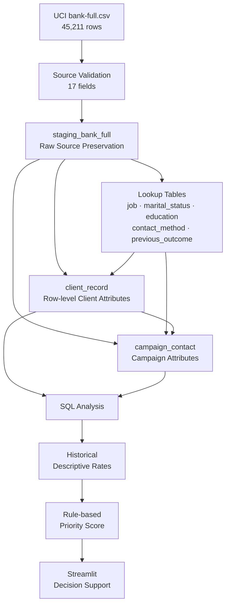

<div align="center">

# Bank Marketing SQL Analysis 🏦

### Relational Data Modeling · SQL Analytics · Rule-based Decision Support

**UCI Bank Marketing 데이터를 관계형 스키마로 재구성하고  
재현 가능한 MySQL 분석 결과를 규칙 기반 마케팅 우선순위 도구로 연결한  
Database & SQL 프로젝트**

<br/>

[](https://www.mysql.com/)
[](https://www.python.org/)
[](https://streamlit.io/)


[](https://github.com/tangerineYR/bank-marketing-sql-analysis/actions/workflows/ci.yml)

</div>

---

## 📌 Overview

이 프로젝트는 데이터베이스 전공 수업에서 수행한 개인 프로젝트로, **은행 텔레마케팅 데이터를 관계형 데이터베이스로 모델링하고 SQL 분석 결과를 마케팅 의사결정 지원 도구로 연결하는 것**을 목표로 했습니다.

UCI Bank Marketing 데이터셋을 MySQL 관계형 스키마로 구성하고, 직업·연령대·연락 월·연락 방식·이전 캠페인 결과에 따른 정기예금 가입률을 SQL로 분석했습니다. 분석에서 관찰된 집단별 가입률을 참고해 5개 요인으로 구성된 규칙 기반 마케팅 우선순위 도구를 구현했습니다.

현재 구현은 **CSV 검증, 트랜잭션 기반 데이터 적재, 반복 실행 시 데이터 중복 방지, 관계형 데이터 무결성 검증 및 자동화 테스트**를 지원합니다.

```text
UCI bank-full.csv
       ↓
Raw Staging
       ↓
Normalized Relational Schema
       ↓
Transactional Loader
       ↓
SQL Descriptive Analysis
       ↓
Rule-based Priority Score
       ↓
Streamlit Decision Support
```

### Project Info

| 항목 | 내용 |
| --- | --- |
| **프로젝트 유형** | 데이터베이스 전공 프로젝트 · 개인 |
| **수행 시기** | 3학년 1학기 |
| **Dataset** | UCI Bank Marketing · `bank-full.csv` |
| **Source Rows** | 45,211 |
| **Database** | MySQL 8.x |
| **Schema** | 1 staging + 7 normalized/domain tables |
| **Analysis** | SQL · Pandas |
| **Application** | Streamlit |
| **Decision Logic** | 5-factor rule-based priority score |
| **Validation** | 21 automated tests · MySQL GitHub Actions |

---

## 🏗️ Architecture



---

## 🗃️ Relational Schema

전체 database는 **8개 table**로 구성됩니다.

```text
1 staging table
+
5 lookup tables
+
1 client_record
+
1 campaign_contact
=
8 tables
```

### Raw Staging

#### `staging_bank_full`

원본 CSV의 모든 17개 field를 보존합니다.

각 row에는:

```text
source_row_id
```

라는 deterministic ID를 부여합니다.

`source_row_id`는 **CSV row를 식별하기 위한 값이며 실제 은행 고객 ID가 아닙니다.**

---

### Lookup Tables

```text
job
marital_status
education
contact_method
previous_outcome
```

반복되는 categorical value를 별도 relation으로 분리하고 각각:

```text
Primary Key
Unique
Not Null
```

제약을 적용합니다.

---

### `client_record`

원본 row의 고객 특성 영역을 담당합니다.

```text
source_row_id
age
job_id
marital_status_id
education_id
default_credit
balance
housing
loan
```

UCI dataset에는 persistent customer identifier가 제공되지 않기 때문에 이 table을 **deduplicated real customer master**라고 해석하지 않습니다.

---

### `campaign_contact`

캠페인 및 연락 정보를 보존합니다.

```text
source_row_id
contact_method_id
day
month
duration
campaign
pdays
previous
previous_outcome_id
subscribed
```

`duration`과 `pdays`를 포함해 데이터셋의 17개 필드를 관계형 테이블에서 보존하고, JOIN을 통해 각 행의 필드를 복원할 수 있도록 구성했습니다.

다만 `duration`은 통화 종료 후에만 알 수 있는 값이므로 **사전 마케팅 대상 priority score에는 사용하지 않습니다.**

---

## 🔒 Transactional & Reproducible Loading

초기 Notebook 중심의 적재 방식에서는 셀을 반복 실행하면 동일 데이터가 중복 삽입될 가능성이 있었습니다. 현재 로더는 전용 데이터베이스의 프로젝트 테이블 내용을 InnoDB 트랜잭션 안에서 교체하고, 커밋 전에 행 수·중복 식별자·외래키 무결성을 검증합니다. 적재 도중 오류가 발생하면 데이터 변경을 롤백합니다.

```text
Validate CSV
     ↓
Acquire DB Load Lock
     ↓
Initialize Schema
     ↓
Begin Transaction
     ↓
Replace Project Data
     ↓
Load Staging
     ↓
Load Lookups
     ↓
Load Relational Tables
     ↓
Integrity Verification
     ↓
Commit
```

오류가 발생하면 transaction을 rollback하여 이전 정상 적재 상태를 유지합니다.

---

### Idempotency

같은 dataset을 두 번 적재해도 row 수가 증가하지 않습니다.

| Relation | First Load | Second Load |
| --- | ---: | ---: |
| Source CSV | 45,211 | 45,211 |
| `staging_bank_full` | 45,211 | 45,211 |
| `client_record` | 45,211 | 45,211 |
| `campaign_contact` | 45,211 | 45,211 |

추가로 다음을 검증합니다.

```text
duplicate source_row_id = 0
FK orphan             = 0
```

그리고 relational tables를 다시 JOIN했을 때 원본 17개 field가 source CSV와 동일하게 복원되는지도 integration test에서 확인합니다.

---

## 📊 SQL Analysis

분석 query는 notebook에서 분리해 [`sql/analysis.sql`](sql/analysis.sql)에 유지합니다.

현재 분석 항목은:

```text
Overall Subscription Rate
Job
Age Band
Contact Month
Contact Method
Previous Campaign Outcome
```

입니다.

모든 grouping 결과의 row count 합계가 원본:

```text
45,211
```

과 일치하는지 자동 검증합니다.

---

## 📈 Descriptive Analysis Results

아래 수치는 **과거 데이터에서 관찰된 기술통계**이며 미래 고객의 가입확률이나 마케팅의 인과 효과를 의미하지 않습니다.

### Overall

```text
Overall Subscription Rate
11.698%
```

---

### Job

| Job | Subscription Rate |
| --- | ---: |
| **Student** | **28.678%** |
| **Retired** | **22.792%** |

특히 student group은 실제 원본 기준 **938 rows**입니다.

---

### Age Band

| Age | Subscription Rate |
| --- | ---: |
| **< 30** | **17.599%** |
| 30–39 | 10.575% |
| 40–49 | 9.121% |
| **50+** | **13.586%** |

이 분석 결과를 기반으로 priority score의 age boundary도 동일하게 맞췄습니다.

---

### Contact Month

| Month | Subscription Rate |
| --- | ---: |
| **March** | **51.992%** |
| **September** | **46.459%** |
| **October** | **43.767%** |
| **December** | **46.729%** |

---

### Contact Method

| Method | Subscription Rate |
| --- | ---: |
| Cellular | 14.919% |
| Telephone | 13.421% |
| Unknown | 4.071% |

---

### Previous Campaign Outcome

이전 캠페인 결과가 `success`인 표본에서는:

```text
64.725%
```

의 가입률이 관찰됐습니다.

이는 전체 가입률 11.698%보다 높은 historical association이지만, **개별 고객의 가입 probability나 causal effect를 의미하지 않습니다.**

---

## 🎯 Rule-based Marketing Priority

이 프로젝트의 Streamlit application은 ML classifier가 아닙니다.

SQL 분석 결과를 참고하여 사람이 설계한:

> **hand-designed heuristic priority score**

입니다.

```text
SQL Descriptive Analysis
        ↓
Manual Business Rules
        ↓
Priority Score
        ↓
4-level Targeting Priority
```

---

### Five Scoring Factors

| Factor | Rule |
| --- | --- |
| **Job** | student / retired +3, selected groups +2 / +1 |
| **Age** | `<30` or `50+` +2, `30–39` +1 |
| **Month** | Mar / Sep / Oct / Dec +2 |
| **Contact** | cellular +2, telephone +1 |
| **Previous Outcome** | success +4, failure −1 |

총 점수 범위는:

```text
-1 ~ 13
```

입니다.

---

### Priority Grades

| Score | Priority |
| --- | --- |
| **8+** | 최우선 타겟 |
| **5–7** | 우선 타겟 |
| **3–4** | 일반 검토 |
| **< 3** | 낮은 우선순위 |

각 결과에는 적용된 5개 factor와 점수 근거를 함께 표시합니다.

예:

```text
+3 직업: student
+2 연령대: 29세
+2 연락 월: mar
+2 연락 방식: cellular
+4 이전 캠페인 결과: success
────────────────────────
13 → 최우선 타겟
```

이 점수는 **calibrated probability가 아닙니다.**

---

## 🧪 Tests & CI

총 21개의 자동화 테스트를 정의했습니다. 이 중 7개는 MySQL 연결이 필요한 통합 테스트로, RUN_DB_TESTS=1 환경변수가 설정된 경우 실행됩니다. GitHub Actions는 전용 MySQL 8.4 서비스를 구성하여 전체 테스트를 실행합니다.

```text
Data contract tests       5
Database integration      7
Scoring tests             9
──────────────────────────
Total                    21
```

주요 검증 범위:

```text
45,211 source rows
17 expected source fields
5,289 subscribed rows
student absolute count = 938

8-table schema
PK / FK / UNIQUE / CHECK constraints
double-load idempotency
full source-column round trip
transaction rollback
foreign-key integrity

SQL aggregate counts
historical descriptive rates

age boundaries
score weights
priority boundaries
score range
invalid input rejection
```

GitHub Actions에서는 MySQL 8.4 service를 실행해 실제 DB integration test까지 수행합니다.

```text
Python 3.12 + MySQL 8.4
          ↓
Install Dependencies
          ↓
Run 21 Automated Tests
          ↓
Execute SQL Analysis
& Validate Summary
          ↓
git diff --check
          ↓
Upload Analysis Artifact
```

현재 `main` workflow는 통과합니다.

---

## 🛠️ Tech Stack

| Category | Technology |
| --- | --- |
| **Database** | MySQL 8.x |
| **SQL** | DDL · JOIN · GROUP BY · CASE · Aggregation |
| **Data Processing** | Python · Pandas |
| **Database Driver** | PyMySQL |
| **Application** | Streamlit |
| **Testing** | Python unittest |
| **CI** | GitHub Actions · MySQL service |
| **Domain** | Relational Modeling · SQL Analytics · Decision Support |

---

## 📁 Project Structure

```text
bank-marketing-sql-analysis/
│
├── bank-full.csv
├── config.py
├── scoring.py
├── 마케팅추천프로그램.py
├── 데이터정규화및분석.ipynb
│
├── sql/
│   ├── schema.sql
│   └── analysis.sql
│
├── scripts/
│   ├── __init__.py
│   ├── load_data.py
│   └── run_analysis.py
│
├── tests/
│   ├── test_data_contract.py
│   ├── test_database.py
│   └── test_scoring.py
│
├── docs/
│   ├── historical-report-2025.pdf
│   └── historical-presentation-2025.pdf
│
├── .github/
│   └── workflows/
│       └── ci.yml
│
├── .env.example
├── .gitignore
├── requirements.txt
└── README.md
```

---

## ▶️ Reproduction

### 1. Environment

Python 3.12와 MySQL 8.x가 필요합니다.

```powershell
git clone https://github.com/tangerineYR/bank-marketing-sql-analysis.git
cd bank-marketing-sql-analysis
python -m venv .venv
.\.venv\Scripts\Activate.ps1
python -m pip install -r requirements.txt
```

macOS 또는 Linux에서는 가상환경 활성화 명령으로 `source .venv/bin/activate`를 사용합니다.

---

### 2. Database Configuration

MySQL에서 프로젝트 전용 데이터베이스와 계정을 생성합니다. 다음 SQL은 관리자 계정으로 실행하세요.

```sql
CREATE DATABASE IF NOT EXISTS bank_marketing
CHARACTER SET utf8mb4;

CREATE USER IF NOT EXISTS 'bank_app'@'127.0.0.1'
IDENTIFIED BY 'replace-with-your-password';

GRANT ALL PRIVILEGES ON bank_marketing.*
TO 'bank_app'@'127.0.0.1';
```

이미 해당 계정이 있다면 실제 계정 암호에 맞춰 환경변수를 설정해야 합니다.

**Windows PowerShell:**

```powershell
$env:DB_HOST = "127.0.0.1"
$env:DB_PORT = "3306"
$env:DB_USER = "bank_app"
$env:DB_PASSWORD = "replace-with-your-password"
$env:DB_NAME = "bank_marketing"
```

macOS/Linux에서는 동일한 변수를 `export DB_HOST=...` 형태로 설정합니다.

`.env.example`은 설정값 참고용입니다. 현재 프로그램은 `.env` 파일을 자동으로 불러오지 않으므로 환경변수를 실행 환경에 직접 설정해야 합니다.

**주의:** 데이터 로더는 지정한 데이터베이스의 프로젝트 테이블 8개를 초기화하거나 기존 데이터를 교체합니다. 다른 업무 데이터가 들어 있는 데이터베이스에서 실행하지 마세요. DB 통합 테스트도 별도의 테스트 데이터베이스를 사용해야 합니다.

실제 비밀번호나 인증 정보는 Git에 커밋하지 않습니다.

---

### 3. Load Data

```bash
python -m scripts.load_data
```

정상 완료 시 JSON 형태로 검증 결과가 출력됩니다. counts의 staging_bank_full, client_record, campaign_contact가 각각 45,211행인지, fk_orphans의 모든 값이 0인지, duplicate_source_row_ids가 0인지 확인합니다.

---

### 4. Run SQL Analysis

```bash
python -m scripts.run_analysis
```

분석 결과는 기본적으로 results/analysis_summary.json에 저장됩니다. results/는 Git 추적에서 제외되며, GitHub Actions 실행 시 분석 결과 JSON을 워크플로 artifact로 업로드합니다.

---

### 5. Run Streamlit

```bash
streamlit run 마케팅추천프로그램.py
```

Streamlit application은 DB에서 실시간 probability prediction을 수행하는 서비스가 아니라, **SQL 분석을 바탕으로 설계한 독립형 rule-based priority tool**입니다.

---

## 🔧 Engineering Decisions & Validation

데이터 적재부터 분석 결과 활용까지, 각 단계의 데이터 무결성과 실행 재현성을 확인할 수 있도록 구성했습니다.

| Concern | Engineering Decision | Verification |
|---|---|---|
| Source Data Integrity | CSV의 17개 필드·45,211행 및 값 범위 검증 | Data contract tests |
| Relational Modeling | 1개 staging, 5개 lookup, 2개 domain table | Schema integration tests |
| Row Identification | CSV 행에 `source_row_id` 부여 | PK·중복 ID 검증 |
| Repeated Loading | 트랜잭션 내 프로젝트 데이터 교체 | Double-load idempotency test |
| Failure Recovery | 적재 실패 시 데이터 변경 롤백 | Rollback test |
| Referential Integrity | PK·FK·UNIQUE·CHECK 제약 적용 | Database constraint tests |
| Source Preservation | 17개 필드를 관계형 테이블 JOIN으로 복원 | Full-column round-trip test |
| SQL Analytics | 분석 SQL을 별도 실행 파일로 관리 | Aggregate count·rate validation |
| Priority Scoring | SQL 기술통계 기반의 명시적 규칙 적용 | Weight·boundary tests |
| Reproducibility | CLI 실행 및 MySQL 통합 CI | GitHub Actions |

데이터 적재 트랜잭션과 테이블 생성 DDL은 구분됩니다. MySQL의 DDL은 암묵적 커밋을 수행하므로, 데이터 적재 실패 시 롤백 보장은 트랜잭션 안에서 수행한 데이터 변경에 적용됩니다.

마케팅 우선순위 점수는 학습된 예측 모델이 아니라, SQL 분석에서 관찰된 집단별 가입률을 참고해 설계한 휴리스틱입니다.

---

## ⚠️ Scope & Limitations

**No Persistent Customer ID**

UCI source에는 실제 고객을 지속적으로 식별할 수 있는 customer ID가 제공되지 않습니다. `client_record`는 source row 단위 relation이며 실제 고객 중복 제거를 의미하지 않습니다.

**Not a Probability Model**

Priority score는 SQL 기술통계를 참고해 사람이 설계한 heuristic rule입니다. 통계적으로 학습되거나 calibration된 가입확률이 아닙니다.

**No Causal Claim**

특정 직업·연령·월·이전 캠페인 결과와 높은 가입률의 관계는 관측된 통계적 연관성입니다. 해당 변수를 바꾸면 가입률이 상승한다는 인과관계를 의미하지 않습니다.

**Duration Excluded from Targeting**

`duration`은 relational schema에는 보존하지만 통화가 종료된 후에만 알 수 있으므로 사전 targeting score에는 사용하지 않습니다.

**Dataset Scope**

이 프로젝트는 UCI Bank Marketing 공개 데이터셋을 사용한 교육 목적의 분석으로, 실제 은행 운영 시스템이나 실시간 고객 데이터와 연결되지 않습니다.

---

## 📚 Dataset Attribution

This project uses the **Bank Marketing** dataset from the UCI Machine Learning Repository.

> Moro, S., Rita, P., & Cortez, P. (2014).  
> *Bank Marketing* [Dataset].  
> UCI Machine Learning Repository.  
> DOI: `10.24432/C5K306`

Dataset license: **CC BY 4.0**

Dataset: [Bank Marketing — UCI Machine Learning Repository](https://archive.ics.uci.edu/dataset/222/bank+marketing)

License: [Creative Commons Attribution 4.0 International](https://creativecommons.org/licenses/by/4.0/)

---

## 🔗 Related Project

### [Bank Marketing MLP — PyTorch Classification](https://github.com/tangerineYR/bank-marketing-mlp)

동일한 UCI Bank Marketing 데이터를 **딥러닝 관점**에서 다룬 별도의 개인 프로젝트입니다.

- **This Project — Database & SQL:** 관계형 스키마 설계, 트랜잭션 기반 데이터 적재, SQL 기술통계 분석, 규칙 기반 마케팅 우선순위 분류
- **Related Project — Deep Learning:** PyTorch MLP 이진 분류, 클래스 불균형 대응, 데이터 누수 방지, 하이퍼파라미터 탐색 및 모델 성능 평가

두 저장소는 같은 데이터셋을 사용하지만, 이 프로젝트는 **관계형 데이터 모델링·SQL 분석**을, 연결된 프로젝트는 **PyTorch 기반 이진 분류와 모델 평가**를 다룹니다.

---

<div align="center">

**Raw Data → Relational Integrity → SQL Evidence → Transparent Decision Rules**

_A decision-support tool should make both its data model and its assumptions inspectable._

</div>
